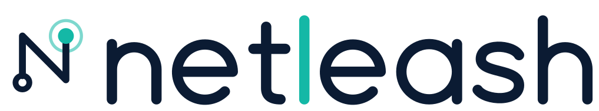

<p align="center">
  <picture>
    <source media="(prefers-color-scheme: dark)" srcset="brand/svg/logo-horizontal-dark.svg">
    
  </picture>
</p>

<p align="center"><a href="README.md">English</a> · <b>Русский</b></p>

# Netleash

*Поводок для сети macOS-приложений на уровне ядра: приложение выходит в сеть только тем маршрутом, который вы выбрали.*

> **Неофициальный, экспериментальный, не проходивший аудит проект.** Не связан с Anthropic и Amnezia, не одобрен и не
> спонсируется ими. Перед установкой прочитайте [Отказ от ответственности](#отказ-от-ответственности) и
> [Ограничения](#ограничения). Программа устанавливает на ваш Mac демон с правами root и setuid-помощника.

Netleash привязывает **сеть одного приложения к VPN-туннелю** на уровне ядра (macOS `pf`).
Если VPN отключился, приложение теряет сеть *в ту же долю секунды*; когда VPN возвращается, возвращается и сеть.

## Поддерживаемая конфигурация (прочитайте сначала)

Сейчас проект работает **только** с таким набором:

| Компонент | Что поддерживается |
|---|---|
| Защищаемое приложение | **Claude для компьютера** (`/Applications/Claude.app`): чат, Claude Code, агенты, встроенный браузер, MCP-серверы и всё, что они запускают |
| VPN | **AmneziaVPN** (`/Applications/AmneziaVPN.app`, проверено на 5.x) |
| **Kill Switch** в AmneziaVPN | **должен быть ВЫКЛЮЧЕН** (см. [почему](#почему-kill-switch-в-amnezia-должен-быть-выключен)) |
| ОС | macOS 26 (Tahoe), Apple Silicon (arm64). Другие версии и Mac на Intel не проверялись |

Всё остальное (другие приложения, другие VPN, другие версии macOS, другие операционные системы) **не поддерживается и не
проверялось**. Поддержка других приложений (например, Codex), других VPN и других платформ планируется, см.
[план развития](#план-развития).

## ⚠️ Claude больше не открывается как раньше

После установки **Claude нужно запускать только через Netleash**. Любой другой способ открыть `Claude.app` (значок Claude
в Dock, Spotlight, Finder, `open -a Claude`, автозапуск при входе, перезапуск после автообновления) приводит к тому, что
приложение будет **завершено примерно за 50 мс**, а вы увидите уведомление «Приложение закрыто». Так сделано нарочно:
Claude без защиты вышел бы в сеть без VPN.

Запускайте Claude одним из способов:

- **значок в строке меню** (зелёная/красная **N**) → **Открыть Claude**;
- **Netleash** в `/Applications` (двойной щелчок, Spotlight или закрепите в Dock вместо Claude);
- из терминала: `netleash run /Applications/Claude.app/Contents/MacOS/Claude`.

Совет: уберите Claude из Dock и закрепите там **Netleash**. Если нужно вернуть прежнее поведение, даже временно, выберите
значок в строке меню → *Аварийный откат*, либо `netleash panic`, либо удалите программу (см.
[Обновление, откат, удаление](#обновление-откат-удаление)). После самостоятельного обновления Claude перезапускается без
защиты и закрывается; просто откройте его снова через Netleash.

## Установка

Выберите один способ, во всех ставятся одни и те же файлы. **Читайте то, что собираетесь запускать:** установщик через
`sudo` ставит демон с правами root и setuid-помощника.

Если Claude запущен, установщик **закрывает его** (сначала обычным выходом, затем принудительно) и **открывает заново
через Netleash**, когда установка закончится: и при первой установке, и при каждом обновлении. Несохранённая работа в
Claude (включая сессию Claude Code внутри него) пропадёт, поэтому сначала сохраните её. Если вы запускаете установщик из
терминала *внутри* Claude, он оставляет Claude открытым (иначе закрылся бы и сам установщик).

### Способ 1 — одна команда

```bash
curl -fsSL https://github.com/sedooj/netleash/releases/latest/download/get.sh | sh
```

`get.sh` скачивает архив релиза, **проверяет его контрольную сумму SHA-256** (и не продолжает при несовпадении),
распаковывает его во временную папку и запускает `install.sh` из архива через `sudo`. Зафиксировать версию можно так:
`NETLEASH_VERSION=v1.2.3`. Запускать скрипт из интернета прямо в оболочке можно доверять ровно настолько, насколько вы
доверяете источнику; если вам это неприятно, используйте способ 2.

### Способ 2 — скачать, проверить, прочитать, потом установить (рекомендуется)

```bash
# 1. скачайте файлы релиза со страницы https://github.com/sedooj/netleash/releases/latest
#    (netleash-darwin-arm64.tar.gz и SHA256SUMS)
shasum -a 256 -c SHA256SUMS            # должно вывести: netleash-darwin-arm64.tar.gz: OK
# по желанию проверьте происхождение сборки (GitHub CLI):
gh attestation verify netleash-darwin-arm64.tar.gz --repo sedooj/netleash
tar -xzf netleash-darwin-arm64.tar.gz
less netleash-darwin-arm64/install.sh  # прочитайте
sudo netleash-darwin-arm64/install.sh
```

### Способ 3 — собрать из исходников

Нужны [Go](https://go.dev/dl/) и, для приложения в строке меню, Xcode или Command Line Tools (`swiftc`).

```bash
git clone https://github.com/sedooj/netleash.git && cd netleash
./build.sh
sudo dist/netleash-darwin-arm64/install.sh
```

Бинарные файлы релиза подписаны ad-hoc и **не нотаризованы**. У файлов, скачанных через `curl`, нет флага карантина,
поэтому Gatekeeper не мешает; если вы скачали архив в браузере и macOS отказывается его запускать, снимите флаг:
`xattr -dr com.apple.quarantine netleash-darwin-arm64`.

### После установки

Запускайте Claude через **Netleash** из `/Applications` (двойной щелчок, Dock, Spotlight или значок в строке меню →
*Открыть Claude*). Любой другой запуск приводит к завершению процесса за ~50 мс. Повторное открытие Netleash никогда не
создаёт второй демон или второй Claude: демон один на систему, а уже запущенный Claude просто выводится на передний план.

Затем проверьте:

```bash
netleash version  # например: "netleash 0.2.0 (commit abc1234, built …, darwin/arm64)"
netleash status   # взведена ли защита, жив ли VPN
netleash test     # принудительное соединение через физический интерфейс ДОЛЖНО быть заблокировано
```

и проверьте вручную: при работающем Claude выключите VPN, и его сеть должна пропасть сразу; включите снова, и она должна
вернуться без перезапуска приложения. Ответ, оборванный на середине, продолжить нельзя (его TCP-соединение умерло вместе с
туннелем); отправьте сообщение заново.

### Настройки и язык

Значок в строке меню → **Настройки…**: **язык** интерфейса (как в системе, English, Русский; действует и для приложения, и
для команды `netleash`), баннеры Netleash вкл/выкл и переход к системным настройкам уведомлений, **ежедневная проверка
обновлений** (по желанию), кнопка «Проверить обновления…» и **запуск при входе**. Если ничего не выбрано, язык следует
системе; для одной команды его можно задать так: `NETLEASH_LANG=ru` или `NETLEASH_LANG=en`. Установщики (`install.sh`,
`get.sh`) пока только на английском.

### Запросы доступа от защищаемого приложения

macOS спрашивает доступ к «Загрузкам», «Документам», экрану и т. д. от имени процесса, который *отвечает* за приложение.
Netleash запускает Claude через небольшую утилиту (`netleash-spawn`), которая делает Claude собственным ответственным
процессом, поэтому запросы должны называть **Claude**. Если запрос называет `netleash-exec` или Netleash, разрешите его
один раз (Системные настройки → Конфиденциальность и безопасность) или сообщите нам в issue: это зависит от внутренностей
macOS.

### Версии

Netleash использует [семантическое версионирование](https://semver.org/lang/ru/); см. [CHANGELOG.md](CHANGELOG.md).
Релиз — это git-тег `vX.Y.Z`, номер которого совпадает с файлом `VERSION`. `netleash version` и приложение в строке меню
показывают версию; сборки из исходников помечаются `X.Y.Z-dev+<коммит>`.

### Обновление, откат, удаление

- **Обновление:** `netleash update` (или значок в строке меню → **Проверить обновления…**). Спрашивает у GitHub последний
  релиз, показывает, что нового, и после вашего подтверждения скачивает его, **проверяет контрольную сумму SHA-256** и
  запускает его установщик (нужен пароль администратора). По умолчанию запросы идут **через VPN** (они выполняются внутри
  той же изоляции, что и защищаемое приложение, поэтому GitHub и провайдер не узнают настоящий адрес этого Mac); если VPN
  выключен, проверка просто не пройдёт. `netleash update --direct` подключается в обход VPN, `--check` только проверяет.
  В меню можно включить **ежедневную проверку** (по умолчанию выключена; при выключенном VPN молчит). Netleash никогда не
  обновляется сам без вашего подтверждения. Повторный запуск команды установки тоже обновляет всё на месте.
- **Аварийный откат:** значок в строке меню → *Аварийный откат*, либо `netleash panic`. Демон останавливается и остаётся
  выключенным после перезагрузки, правила pf снимаются. Включить снова: *Вернуть защиту* или `netleash resume`.
- **Удаление:** `sudo /usr/local/libexec/netleash/uninstall.sh`

## Как это работает

Защищаемое приложение запускается лаунчером в выделенной группе `_netleash` (все остальные группы сброшены, вернуть их
нельзя). К этой группе применяется якорь `pf`:

1. разрешён loopback (кроме портов известных локальных прокси, через которые можно было бы обойти VPN);
2. разрешены TCP/UDP **только** через интерфейс `utunN` VPN;
3. всё остальное блокируется (`block drop quick`).

Разрешающее правило привязано к *имени* интерфейса. Когда туннель исчезает, правило просто перестаёт совпадать, и ядро
блокирует трафик без опросов и гонок, даже если демон умер. После переподключения VPN демон (за ~0,5 с) направляет
правило на новый `utunN`.

**DNS** разрешает системный `mDNSResponder`, который не входит в защищаемую группу, поэтому в якоре есть ещё два правила,
действующие на всех:

- DNS-серверы самого VPN никогда не должны опрашиваться через физический интерфейс (так бывает на короткое время при
  подключении VPN). Адреса определяются **автоматически**: частные адреса из `scutil --dns`, до которых есть хост-маршрут
  через интерфейс VPN, за исключением подсетей, напрямую подключённых к физическим интерфейсам; их можно задать и вручную
  (`vpnDnsServers`);
- пока VPN выключен **и** защищаемое приложение запущено, *весь* DNS (53/853) на физических интерфейсах блокируется, чтобы
  ни одно имя хоста не покидало компьютер. Другие программы в это время тоже не смогут разрешать имена.

Якорь лежит в `com.apple/050.netleash`. Штатный `/etc/pf.conf` Apple уже ссылается на `anchor "com.apple/*"`, поэтому
программы, перезагружающие главный набор правил, его не удаляют.

### Компоненты

| Компонент | Язык | Роль |
|---|---|---|
| `netleash` (`cmd/netleash`) | Go | Один бинарный файл: **демон** root (`netleash daemon`, запускается launchd при загрузке) и **CLI** (`status`, `test`, `panic`, `resume`, `update`, `log`, `run`, `version`). Демон определяет живой VPN, держит якорь, возвращает ссылки pf, завершает процессы защищаемого приложения, запущенные мимо лаунчера (проверка каждые 50 мс), и уведомляет |
| `netleash-exec` (`cmd/netleash-exec`) | Go | Setuid-помощник: запускает команду от *вашего* пользователя только с группой `_netleash`; отказывается стартовать, если защита не взведена. Он только понижает привилегии |
| `Netleash.app` (`app/Netleash`) | Swift | Лаунчер защищаемого приложения, значок состояния в строке меню (зелёный: VPN работает · красный: VPN отключён, приложение заблокировано · оранжевый: защита не работает), проверка утечек, просмотр журнала, автозапуск при входе, аварийный откат / возврат |
| `packaging/*.sh`, `get.sh` | shell | Установщик, деинсталлятор, скрипты отката, загрузчик |

Чистая логика (генерация правил pf, разбор `netstat`/`scutil`/`ifconfig`, конфиг) лежит в `internal/` вместе с модульными
тестами, включая тесты, проверяющие, что сгенерированные правила не пропускают трафик при сбое (fail-closed).

## Настройка

`/usr/local/etc/netleash/config.json` (все ключи необязательны):

| Ключ | По умолчанию | Значение |
|---|---|---|
| `protectedAppPath` | `/Applications/Claude.app` | приложение, которое ограничиваем |
| `vpnAppPath` | `/Applications/AmneziaVPN.app` | VPN, туннель которого — единственный разрешённый маршрут |
| `enforceLauncherOnly` | `true` | завершать процессы защищаемого приложения, запущенные мимо лаунчера |
| `notify` | `true` | системные уведомления |
| `loopbackBlockPorts` | `[7890, 7891, 7892, 7897, 9090, 9097]` | порты локальных прокси, недоступные приложению |
| `vpnDnsServers` | `["100.64.0.1"]` | DNS-серверы VPN, которым нельзя выходить через физические интерфейсы |
| `autoDetectVpnDns` | `true` | определять остальные автоматически |
| `ignoreCommandSubstrings` | `["/Squirrel.framework/"]` | пути внутри приложения, которые не завершаются (апдейтер) |

После правки: `sudo launchctl kickstart -k system/org.netleash.daemon`.

## Почему Kill Switch в Amnezia должен быть выключен

Kill switch в Amnezia перезагружает главный набор правил `pf` *неатомарно* при каждой смене состояния подключения. На
~10–30 мс набор правил становится пустым, и в это окно системный резолвер может отправить DNS-запросы мимо туннеля. Для
защищаемого приложения этот проект выполняет ту же функцию (и строже), поэтому kill switch нужно выключить.
**Следствие:** остальные приложения на вашем Mac больше не защищены kill switch'ем Amnezia, если VPN отключится.

## Ограничения

- **Поддерживается только Claude + AmneziaVPN с выключенным Kill Switch.** Другие сочетания не проверялись и могут навсегда
  заблокировать приложение или оставить его без защиты.
- «VPN жив» означает: процесс VPN-приложения существует **и** его интерфейс `utunN` несёт маршрут по умолчанию.
  Зависший туннель, который выглядит живым, ничего не блокирует, но и ничего не передаёт (утечки нет, связи тоже).
- `pf` не умеет фильтровать ICMP по группе; ICMP не ограничивается (он не несёт данных приложения).
- Процессы, которые приложение запускает *через launchd* (`open`, `launchctl submit`, элементы входа), получают другой gid
  и не изолируются.
- Копия приложения, запущенная мимо лаунчера, живёт до ~50 мс, пока демон её не завершит; в это окно она не изолирована.
  Автообновления перезапускают приложение без защиты; оно завершается, и вы запускаете его снова через лаунчер.
- Пока VPN выключен и защищаемое приложение запущено, DNS блокируется **для всей системы** на физических интерфейсах.
- Локальная сеть для защищаемого приложения недоступна.
- Не рассчитано на злонамеренный процесс с правами root, недобросовестного администратора или скомпрометированную ОС.
- Обновления доверяют GitHub-релизам этого репозитория: контрольная сумма берётся из того же релиза, поэтому она защищает от
  повреждённых и подменённых загрузок, но не от взломанного репозитория или аккаунта. Для большей уверенности проверьте
  аттестацию происхождения сборки (`gh attestation verify`, см. Установка, способ 2).
- Код не проходил аудит; бинарные файлы подписаны ad-hoc, не нотаризованы.

## Отказ от ответственности

**ПРОГРАММА ПРЕДОСТАВЛЯЕТСЯ «КАК ЕСТЬ», БЕЗ КАКИХ-ЛИБО ГАРАНТИЙ**, явных или подразумеваемых, включая (но не ограничиваясь)
гарантии товарной пригодности, пригодности для конкретной цели и ненарушения прав. Ни при каких обстоятельствах авторы
и участники проекта не несут ответственности по каким-либо искам, убыткам и иным требованиям, включая потерю данных,
потерю сетевого соединения, блокировку аккаунта, инциденты приватности или безопасности и юридические последствия, как
по договору, так и по деликту или иному основанию, возникающим из программы или её использования. См. разделы 15–17
[GNU GPL v3](LICENSE) (оригинальный текст лицензии на английском языке имеет юридическую силу).

- **Это не гарантия безопасности.** Инструмент снижает риск того, что одно приложение выйдет в сеть в обход VPN. Он **не**
  гарантирует анонимность, приватность или отсутствие утечек. Проверяйте сами (`netleash test`, перехват пакетов) и не
  полагайтесь на него там, где сбой имел бы серьёзные последствия.
- **Он меняет вашу систему:** устанавливает LaunchDaemon от root, setuid-помощника с правами root, локальную группу и
  правила `pf`. Ошибки могут нарушить работу сети. Используйте на свой риск; сначала прочитайте код.
- **Сторонние сервисы и условия.** Вы сами отвечаете за соблюдение условий использования и политик каждого сервиса, которым
  пользуетесь (включая правила доступности в вашем регионе), и законов, применимых к вам, включая законы об использовании
  VPN. **Проект не является средством получения доступа к какому-либо сервису в нарушение его условий или применимого
  закона и не должен использоваться или продвигаться как таковой.** Это универсальный инструмент сетевой изоляции.
- **Товарные знаки.** «Claude» и «Anthropic» — товарные знаки Anthropic, PBC; «AmneziaVPN» — товарный знак соответствующего
  владельца. Они используются здесь только для описания совместимости. Это независимый неофициальный проект.
  Логотип и значки Netleash — оригинальные работы под той же лицензией, что и код; чужие графические материалы в
  репозитории не распространяются.
- **Нет обязательств по поддержке.** Сообщения об ошибках и pull request'ы приветствуются, но сопровождающий сам решает, что
  принимать, и никому не обязан отвечать, исправлять ошибки или придерживаться графика выпусков.

## План развития

Пока не реализовано; ничто из перечисленного сейчас не поддерживается:

- другие защищаемые приложения (например, Codex), задаваемые настройкой, а не зашитые в код;
- другое VPN-ПО и обычные туннели WireGuard/OpenVPN (универсальное определение «туннель поднят»);
- поддержка при включённом kill switch в Amnezia (слой, переживающий перезагрузки `pf`);
- другие операционные системы (ядро на Go, платформенные части изолированы; для Linux понадобится другой файрвол);
- нотаризованные релизы, больше автоматических тестов, другие языки.

## Участие и безопасность

См. [CONTRIBUTING.ru.md](CONTRIBUTING.ru.md), [SUPPORT.ru.md](SUPPORT.ru.md) и [SECURITY.ru.md](SECURITY.ru.md).

## Лицензия

GPL-3.0-or-later. См. [LICENSE](LICENSE).
